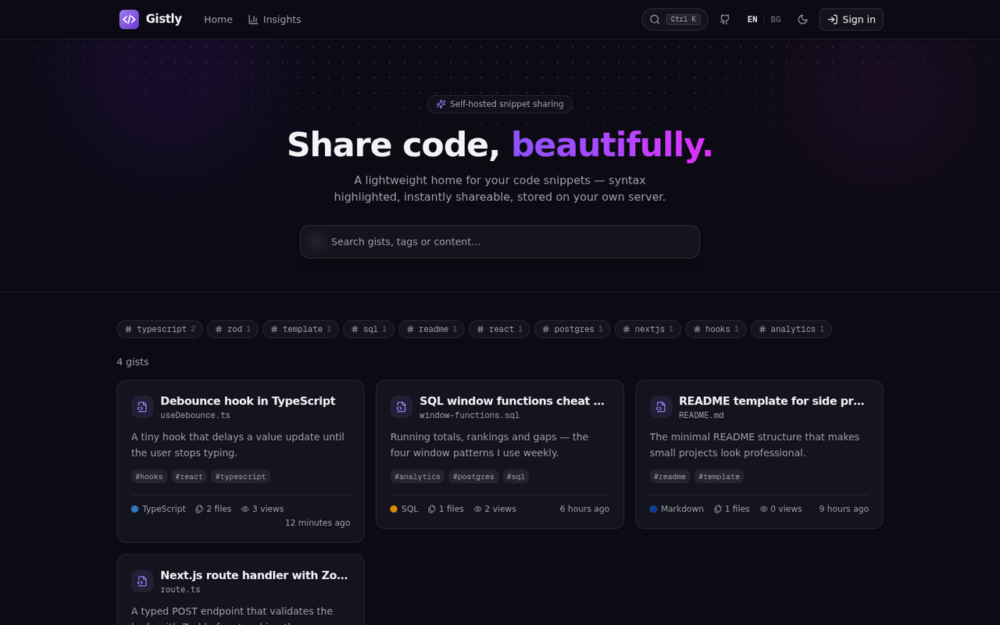
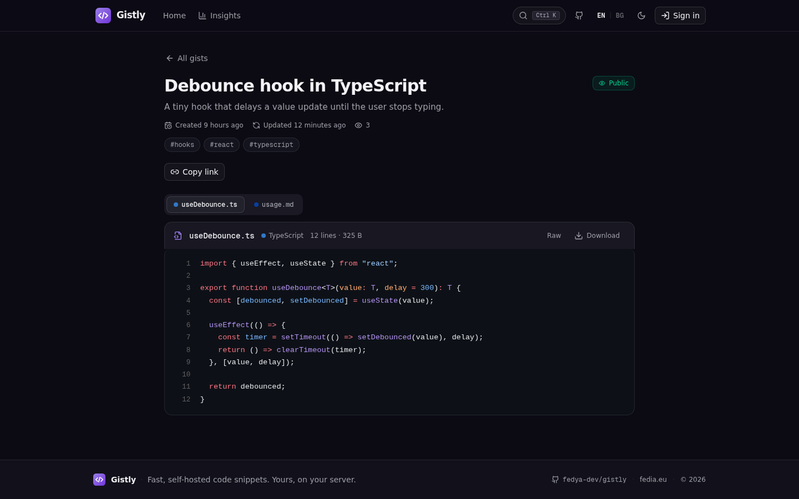
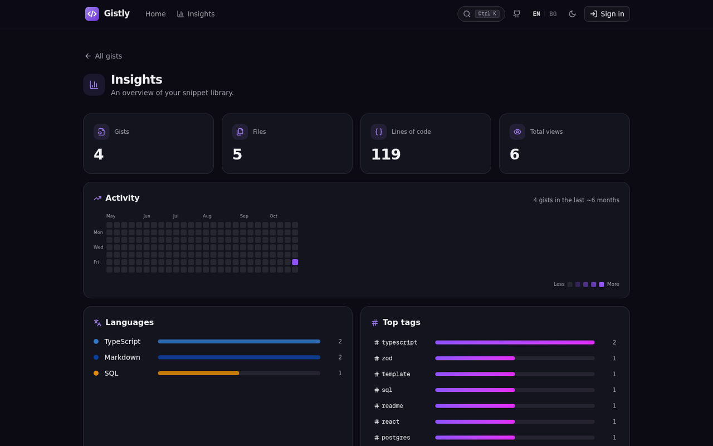
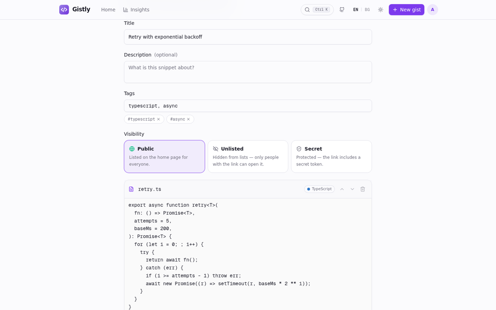
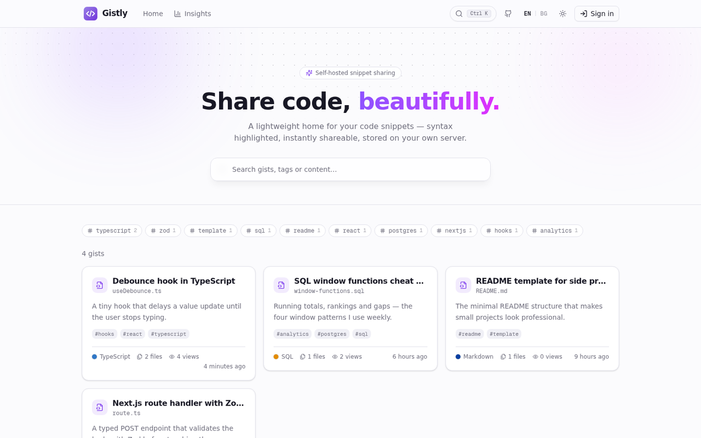
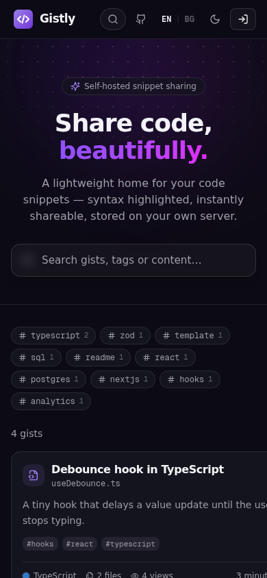

# Gistly

<p align="center">
  <strong>Beautiful, self-hosted code snippet sharing.</strong><br/>
  Syntax highlighted · instantly linkable · entirely yours.
</p>

---

**English** · [Български](#български)

Gistly is a lightweight, open-source alternative to GitHub Gists / OpenGist that you can run on **your own server** with a single Docker command. Paste code, get a link, share it. Everything lives in one SQLite file on your machine.

## Screenshots

| | |
| --- | --- |
|  |  |
|  |  |
|  |  |

<p align="center"></p>

## Features

- 🎨 **Syntax highlighting** — Shiki with the official GitHub Light & GitHub Dark themes, 40+ languages, line numbers, soft-wrap toggle
- 📝 **Markdown preview** — `.md` files render with tables, task lists and highlighted code blocks (GFM)
- 🔐 **Single-admin mode** — only you (password login) create and edit gists; everyone else just opens links
- 👁 **Three visibility levels** — *Public* (listed), *Unlisted* (link-only), *Secret* (link + token)
- 🔎 **Full-text search** and **tags** (`#typescript`, `#sql` …) with a clickable tag cloud
- 📊 **Insights dashboard** — GitHub-style activity heatmap, language & tag stats, most-viewed and latest gist
- ⌨️ **Command palette** — press <kbd>Ctrl</kbd>+<kbd>K</kbd> anywhere to search gists and run commands
- 📄 **Infinite feed** — “Load more” pagination with live result counters
- 📋 **Copy / Raw / Download** for every file, copy-link button with toast
- 🌗 **Dark & light theme** (dark by default) and a **EN / BG bilingual interface**
- 🐳 **Docker-first** — multi-stage image, persistent SQLite volume, `docker compose up -d` and done
- ⚡ **Modern stack** — Next.js 16 (App Router), TypeScript, Tailwind CSS 4, shadcn/ui, Prisma, Framer Motion

## Quick start (Docker Compose)

```bash
git clone https://github.com/fedya-dev/gistly.git
cd gistly

# optional but recommended: set a strong admin password + session secret
echo "ADMIN_PASSWORD=my-strong-password"  > .env
echo "AUTH_SECRET=$(openssl rand -hex 32)" >> .env

chmod +x deploy.sh
./deploy.sh
```

Open **http://localhost:3000** → click **Sign in** → enter your `ADMIN_PASSWORD` (default: `admin`) → create your first gist.

> **Why `./deploy.sh` and not `docker compose up -d --build`?** The build uses
> the host network (see `docker-compose.yml`), and Compose ≥ 2.36 builds
> through BuildKit Bake, which fails with
> `additional privileges requested: pass "--allow=network.host"`.
> `deploy.sh` builds with `docker buildx build --allow=network.host --network host`
> and then starts compose. On healthy hosts `docker compose up -d --build`
> also works.

## Plain `docker run`

```bash
docker build -t gistly .
docker run -d --name gistly \
  -p 3000:3000 \
  -v gistly_data:/app/db \
  -e ADMIN_PASSWORD=my-strong-password \
  -e AUTH_SECRET=$(openssl rand -hex 32) \
  --restart unless-stopped \
  gistly
```

> **Server with broken Docker networking?** If builds hang at `bun install`
> with `EAI_AGAIN`, or starting the container fails with iptables errors, your
> host's Docker bridge/iptables layer is misconfigured (common on Proxmox LXC).
> Or if Compose ≥ 2.36 stops with `additional privileges requested: pass
> "--allow=network.host"`. Workaround: use `./deploy.sh`, or build and run
> with the host network manually —
> `docker buildx build --allow=network.host --network host -t gistly:latest .`
> and `docker compose up -d`, or `docker run --network host ...` (drop
> `-p 3000:3000`), or set `[worker.oci] networkMode = "host"` in
> `/etc/docker/buildkitd.toml`.

## Environment variables

| Variable          | Default              | Description                                          |
| ----------------- | -------------------- | ---------------------------------------------------- |
| `ADMIN_PASSWORD`  | `admin`              | Password for the admin. **Change it in production!** |
| `AUTH_SECRET`     | derived from password| Secret used to sign the session cookie (`openssl rand -hex 32`) |
| `DATABASE_URL`    | `file:/app/db/gistly.db` | SQLite file location (inside the container)      |
| `PORT`            | `3000`               | HTTP port                                            |

## Sharing links

| Visibility | Link                                                | Listed on home |
| ---------- | --------------------------------------------------- | -------------- |
| Public     | `https://your-domain/?g=<id>`                       | ✅             |
| Unlisted   | `https://your-domain/?g=<id>`                       | ❌             |
| Secret     | `https://your-domain/?g=<id>&t=<token>`             | ❌             |

Every gist page has a **Copy link** button that copies the full, correct URL for the chosen visibility.

## Deploying from GitHub to any server

1. Push this project to a GitHub repository.
2. On your VPS (Hetzner, DigitalOcean, OVH, a Raspberry Pi…): `git clone` your repo.
3. `chmod +x deploy.sh && ./deploy.sh` — that's the whole deployment.
4. Updates: `git pull && ./deploy.sh`. Your data survives in the `gistly_data` volume.

Customizing (header, footer, colors, texts…): see **[CUSTOMIZE.md](CUSTOMIZE.md)** — a map of where every visible part of the app lives.

### HTTPS with a reverse proxy

Point any reverse proxy at port `3000`. Examples:

**Caddy** (automatic HTTPS):

```
gist.example.com {
    reverse_proxy localhost:3000
}
```

**Nginx:**

```nginx
server {
    server_name gist.example.com;
    location / {
        proxy_pass http://localhost:3000;
        proxy_set_header Host $host;
        proxy_set_header X-Forwarded-For $proxy_add_x_forwarded_for;
        proxy_set_header X-Forwarded-Proto $scheme;
    }
}
```

## Good to know

- **Backups:** copy the SQLite file from the volume (`docker cp gistly:/app/db/gistly.db backup.db`) or use the bind mount `./data:/app/db`.
- **Static-only hosts** (GitHub Pages, Netlify static) will **not** work — Gistly needs a Node/Bun process for its API and database. Any VPS, Railway, Fly.io or Coolify instance works out of the box.
- **First login:** with no `ADMIN_PASSWORD` set the password is `admin` — sign in and change it immediately.
- **Reset demo data:** the bundled `scripts/seed.mts` only runs locally (`bun scripts/seed.mts`), never in the Docker image.

## Tech stack

Next.js 16 · TypeScript · Tailwind CSS 4 · shadcn/ui · Prisma + SQLite · Shiki · react-markdown + remark-gfm · Framer Motion · next-themes · Sonner

## License

[MIT](LICENSE)

---

## Български

**English** above · [Back to top](#gistly)

Gistly е лека алтернатива с отворен код на GitHub Gists / OpenGist, която работи на **твоя сървър** с една Docker команда. Поставяш код, получаваш линк, споделяш го. Всичко се съхранява в един SQLite файл на твоята машина.

### Скрийншоти

| | |
| --- | --- |
|  |  |
|  |  |
|  |  |

<p align="center"></p>

### Възможности

- 🎨 **Оцветяване на кода** — Shiki с официалните GitHub Light & GitHub Dark теми, 40+ езика, номера на редовете
- 📝 **Markdown преглед** — `.md` файловете се рендират с таблици, списъци и оцветени код блокове
- 🔐 **Само админ качва** — вход с парола; всички останали само отварят линковете
- 👁 **Три нива на видимост** — Публичен, Скрит (само с линк), Частен (линк + токен)
- 🔎 **Търсене** по заглавие, съдържание и тагове + облак от тагове
- 📊 **Статистика (Insights)** — heatmap на активността в GitHub-стил, разпределение по езици, топ тагове, най-гледан и последен гист
- ⌨️ **Командна палитра** — <kbd>Ctrl</kbd>+<kbd>K</kbd> навсякъде за търсене на гистове и команди
- 📄 **Безкрайна лента** — „Зареди още“ пагинация с брояч
- 📋 **Копирай / Суров / Изтегли** за всеки файл + бутон за копиране на линка
- 🌗 **Тъмна и светла тема** и **двуезичен интерфейс EN / BG**
- 🐳 **Docker** — multistage образ, SQLite том, `docker compose up -d`

### Бърз старт

```bash
git clone https://github.com/fedya-dev/gistly.git
cd gistly

echo "ADMIN_PASSWORD=силна-парола"          > .env
echo "AUTH_SECRET=$(openssl rand -hex 32)" >> .env

chmod +x deploy.sh
./deploy.sh
```

Отвори **http://localhost:3000** → **Вход** → въведи паролата (по подразбиране: `admin`) → създай първия гист.

> **Защо `./deploy.sh` вместо `docker compose up -d --build`?** Билдът ползва
> host мрежата (виж `docker-compose.yml`), а Compose ≥ 2.36 билдва през
> BuildKit Bake и гърми с `additional privileges requested: pass
> "--allow=network.host"`. `deploy.sh` билдва с
> `docker buildx build --allow=network.host --network host` и после пуска
> compose. На здрави хостове и `docker compose up -d --build` работи.

### Качване в GitHub → деплой където и да е

1. Качи проекта в GitHub хранилище.
2. На сървъра: `git clone` и после `chmod +x deploy.sh && ./deploy.sh`.
3. За обновление: `git pull && ./deploy.sh`. Данните остават в тома `gistly_data`.
4. HTTPS: насочи Caddy/Nginx (примерите по-горе) към порт `3000`.

Персонализация (хедър, футър, цветове, текстове…): виж **[CUSTOMIZE.md](CUSTOMIZE.md)** — указател къде се намира всяка видима част от приложението.

### Полезно да знаеш

- **Резервни копия:** `docker cp gistly:/app/db/gistly.db backup.db` или bind mount `./data:/app/db`.
- **Статични хостинги** (GitHub Pages) не работят — трябва сървър с Node/Bun (VPS, Railway, Fly.io, Coolify).
- **Смяна на паролата:** задай `ADMIN_PASSWORD` в `.env` и рестартирай: `docker compose up -d`.
